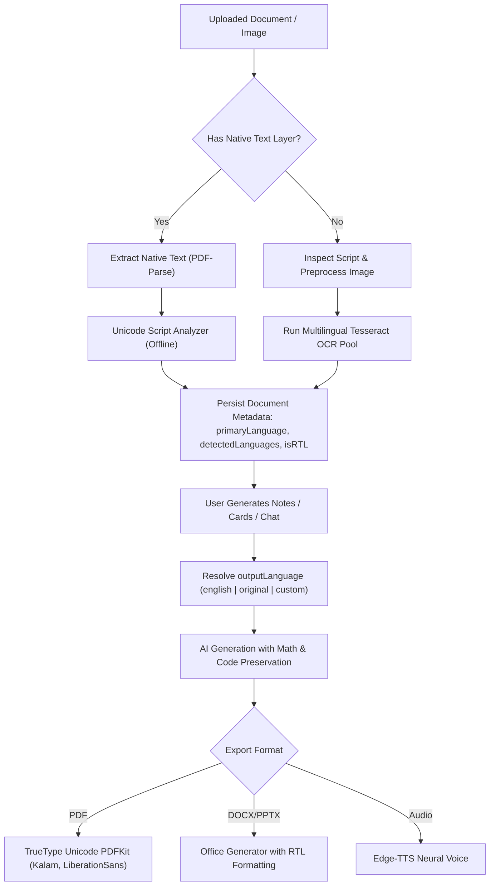

# Notivexa Multilingual Architecture & Documentation

## Overview

Notivexa includes an end-to-end multilingual processing engine supporting 17 core languages across:
1. **Multilingual OCR & Text Extraction**: Automatic script & language detection from native digital PDFs or scanned documents/images, with manual override support.
2. **On-Demand Tesseract Models**: Dynamic download and local caching of `.traineddata` files into `backend/data/ocr-lang-data/`, with a bounded worker pool and offline `eng` fallback.
3. **Language-Keyed OCR Caching**: Cache keys combine SHA-256 document content hashes with language sets (`${hash}_${langSet}.json`) to avoid cross-language collisions.
4. **Universal Output Language**: Users can generate notes, summaries, flashcards, questions, mind maps, video scripts, podcasts, and chat responses in English, the document's original language, or any specific target language.
5. **Unicode-Safe Multi-Script PDF Generation**: PDFKit embeds TrueType Unicode fonts (Kalam for Devanagari, LiberationSans for Cyrillic, NanumPenScript for Hangul) to prevent WinAnsiEncoding exceptions.
6. **Office Exports with RTL Support**: DOCX and PPTX generators support Right-to-Left (RTL) scripts for Arabic and Urdu.
7. **Neural Audio Lectures**: Edge-TTS integration maps 17 localized neural voices for natural podcast generation.

---

## Supported Languages & Scripts

| Language | ISO 639-1 | Tesseract Code | Script | Direction | Edge-TTS Voice |
| :--- | :--- | :--- | :--- | :--- | :--- |
| **English** | `en` | `eng` | Latin | LTR | `en-US-JennyNeural` / `en-IN-PrabhatNeural` |
| **Hindi** | `hi` | `hin` | Devanagari | LTR | `hi-IN-SwaraNeural` |
| **Marathi** | `mr` | `mar` | Devanagari | LTR | `mr-IN-AarohiNeural` |
| **Gujarati** | `gu` | `guj` | Gujarati | LTR | `gu-IN-DhwaniNeural` |
| **Bengali** | `bn` | `ben` | Bengali | LTR | `bn-IN-TanishaaNeural` |
| **Tamil** | `ta` | `tam` | Tamil | LTR | `ta-IN-PallaviNeural` |
| **Telugu** | `te` | `tel` | Telugu | LTR | `te-IN-ShrutiNeural` |
| **Kannada** | `kn` | `kan` | Kannada | LTR | `kn-IN-SapnaNeural` |
| **Urdu** | `ur` | `urd` | Arabic | RTL | `ur-IN-GulNeural` |
| **Arabic** | `ar` | `ara` | Arabic | RTL | `ar-SA-ZariyahNeural` |
| **Spanish** | `es` | `spa` | Latin | LTR | `es-ES-ElviraNeural` |
| **French** | `fr` | `fra` | Latin | LTR | `fr-FR-DeniseNeural` |
| **German** | `de` | `deu` | Latin | LTR | `de-DE-KatjaNeural` |
| **Chinese (Simplified)** | `zh` | `chi_sim` | Han | LTR | `zh-CN-XiaoxiaoNeural` |
| **Japanese** | `ja` | `jpn` | Japanese | LTR | `ja-JP-NanamiNeural` |
| **Korean** | `ko` | `kor` | Hangul | LTR | `ko-KR-SunHiNeural` |
| **Russian** | `ru` | `rus` | Cyrillic | LTR | `ru-RU-SvetlanaNeural` |

---

## Pipeline Flow



---

## Script & Language Detection Heuristics

`backend/services/ocr/languageDetectionService.js` operates 100% offline with zero external dependencies using Unicode code points:
1. **Character Block Range Matching**: Classifies character distributions across Latin, Devanagari, Gujarati, Bengali, Tamil, Telugu, Kannada, Arabic, Cyrillic, Hangul, Japanese Kana, and CJK Han.
2. **Devanagari Disambiguation (Hindi vs Marathi)**:
   - Evaluates retroflex lateral approximant **ळ** (`\u0933`).
   - Analyzes common Marathi inflectional grammatical markers (`आहे`, `नाही`, `आणि`, `करून`, `होते`, `झाले`, `म्हणून`).
3. **Arabic vs Urdu Disambiguation**:
   - Detects Urdu-specific characters: `ے` (`\u06D2`), `ٹ` (`\u0679`), `ڈ` (`\u0688`), `ڑ` (`\u0691`), `چ` (`\u0686`).
4. **Mixed Script Detection**:
   - Accurately identifies mixed-script texts (e.g., Hindi documents containing English technical terms) and assigns combined OCR models like `hin+eng` or `mar+eng`.

---

## On-Demand Traineddata Management

To avoid repository bloat, language model files (`.traineddata`) are downloaded on-demand and cached locally:
- **Storage Location**: `backend/data/ocr-lang-data/` (ignored by `.gitignore` except `eng.traineddata`).
- **Primary Source**: `https://github.com/tesseract-ocr/tessdata_fast/raw/main/`
- **Fallback Mirror**: `https://raw.githubusercontent.com/tesseract-ocr/tessdata/main/`
- **Offline Fallback**: If network is unavailable or download fails, the system automatically falls back to bundled `eng.traineddata` with zero unhandled exceptions.

---

## Output Language Resolution (`outputLanguage`)

All `/api/generate/*` routes and `/api/chatbot/message` accept the `outputLanguage` parameter:
- `"original"`: Instructs the model to generate responses in the document's detected primary language.
- `"english"` (Default): Generates responses in English, keeping technical source terms in brackets where applicable.
- ISO 639-1 code (e.g. `"hi"`, `"mr"`, `"de"`, `"fr"`, `"es"`, `"ar"`, `"ru"`, `"zh"`): Generates directly in the requested language.
- English Language Name (e.g. `"Hindi"`, `"Marathi"`, `"German"`): Automatically normalized to the canonical language.

### AI Prompt Preservation Rules
When translating or generating content in target languages:
- Mathematical equations, LaTeX expressions, and formulas are preserved verbatim.
- Variable names, functions, code snippets, and terminal commands remain untranslated.
- Numbers, dates, and technical proper nouns are retained in international format.

---

## Verification & Automated Tests

Run the multilingual test suite:
```bash
cd backend
npx jest tests/multilingual.test.js --runInBand
```
Tests cover:
- Script & language detection across all script families.
- RTL script classification.
- Output language resolution edge cases.
- Traineddata on-demand downloading and offline fallback.
- Unicode PDF rendering for Devanagari (Hindi/Marathi) and Cyrillic (Russian).
- Arabic DOCX and PPTX exports with RTL mode enabled.
